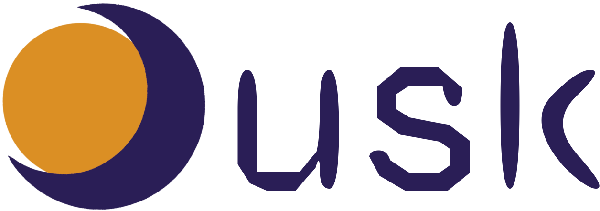

# Dusk Programming Language

A general-purpose, statically typed language with its own runtime: a bytecode VM, garbage collection and lightweight tasks built in

> 🚧 Very early work in progress 🚧

[Language Reference](doc/language-ref.md)

[Building & Running](doc/build.md)

[Roadmap](doc/roadmap.md)

[Changelogs](doc/changelogs.md)

[Benchmarks](benchmarks/benchmark.md)

[AI Usage](doc/ai-disclaimer.md)

[Contributing](https://github.com/guilhermeg2k/dusk-lang/blob/main/doc/contributing.md)

[License](https://github.com/guilhermeg2k/dusk-lang/blob/main/LICENSE)

Made by Guilherme (~\_^)
