# Benchmark

Cross-language micro-benchmarks tracking **Dusk** against a native **Zig** baseline and five mainstream runtimes. Wall time is measured externally with [`hyperfine`](https://github.com/sharkdp/hyperfine) and peak memory with GNU `/usr/bin/time`; the benchmark programs contain **no timing or instrumentation code**.
> This benchmark is not evidence that X is faster than Y, its main purpose is to track Dusk performance specially on versions change, so we can notice performance problems/gains.

Regenerate this file with:

```bash
python3 run_benchmarks.py

```
## Machine

| Field | Value |
| --- | --- |
| OS | Fedora Linux 44 (Workstation Edition) |
| Kernel | Linux 7.3.3-200.fc44.x86_64 |
| Architecture | x86_64 |
| CPU | AMD Ryzen 5 5600X 6-Core Processor |
| Cores / Threads | 6 cores / 12 threads |
| CPU max | 4.65 GHz |
| Memory | 31.2 GiB total |
| Date | 2026-11-15 02:40 UTC |

## Language toolchains

| Language | Version / mode |
| --- | --- |
| **Dusk** | **0.15.0 (git 8fe5154) — built with Zig 0.16.0, ReleaseFast** |
| Zig (native) | 0.16.0 — native baseline, build-exe -OReleaseFast |
| Java | openjdk version 25.0.5 2026-10-20 — precompiled with javac, JVM startup included |
| Node.js | v22.23.1 |
| Python 3 | Python 3.14.10 |
| Ruby | ruby 4.0.9 (2026-10-23 revision 3e93b23afc) +PRISM |
| Lua | Lua 5.4.8  Copyright (C) 1994-2025 Lua.org, PUC-Rio |
| hyperfine | hyperfine 1.20.0 |

## Methodology

- Wall time is sampled by hyperfine with `--warmup 2 --min-runs 5 -N` (no intermediate shell).
- Peak memory is the resident-set high-water mark from `/usr/bin/time -f %M`, reported as the **median of 3 runs**. It includes the runtime/interpreter footprint (JVM, V8, CPython, the Dusk VM, …) plus the workload.
- **Zig (native)** is the baseline: compiled with `zig build-exe -OReleaseFast`. The **Relative** column and the summary charts are normalised to it (Zig = 1.00×, i.e. "× slower than native").
- No external libraries are used by any benchmark program.
- Every program is verified to print the expected result before measuring.

## Results

### Recursive Fibonacci (`fib`)

Compute fib(35) with pure recursion (fib(n-1) + fib(n-2)).

Expected output: `9227465`

| Language | Mean | Std dev | Min | Max | Relative | Peak mem |
| --- | --- | --- | --- | --- | --- | --- |
| Zig (native) | 20.3 ms | 724.4 µs | 19.2 ms | 22.8 ms | 1.00× | 0.7 MiB |
| Java | 44.1 ms | 1.6 ms | 41.1 ms | 48.6 ms | 2.17× | 38.1 MiB |
| Node.js | 152.4 ms | 7.6 ms | 146.7 ms | 181.1 ms | 7.51× | 58.6 MiB |
| **Dusk** | **408.5 ms** | **8.3 ms** | **396.3 ms** | **420.5 ms** | **20.13×** | **3.1 MiB** |
| Lua | 468.0 ms | 5.9 ms | 460.9 ms | 477.3 ms | 23.07× | 2.8 MiB |
| Ruby | 721.1 ms | 13.3 ms | 704.8 ms | 731.9 ms | 35.54× | 14.3 MiB |
| Python 3 | 943.9 ms | 25.1 ms | 923.0 ms | 987.5 ms | 46.52× | 9.1 MiB |

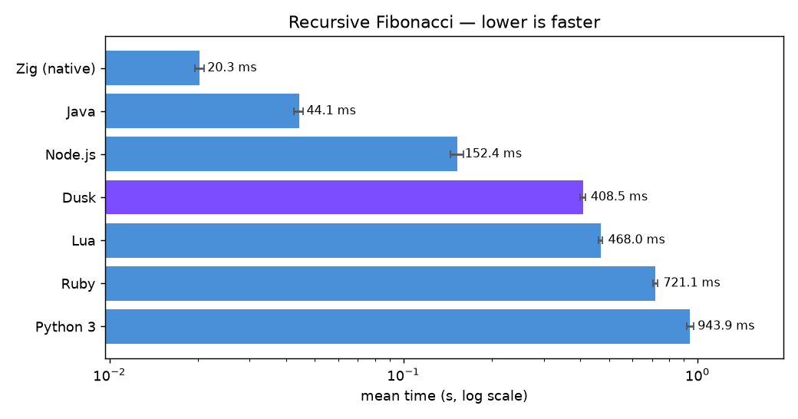

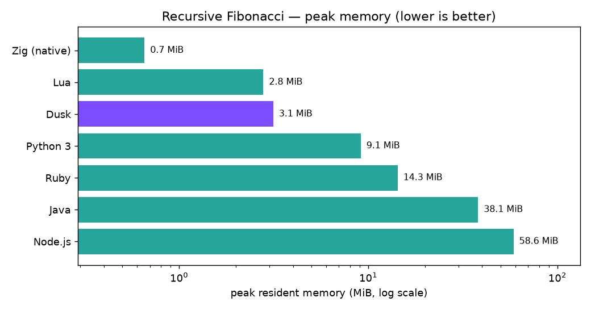

### Particle System (`particles`)

100,000 particles, 100 update passes of x += vx / y += vy; print x of the 50,000th particle.

Expected output: `50049`

| Language | Mean | Std dev | Min | Max | Relative | Peak mem |
| --- | --- | --- | --- | --- | --- | --- |
| Zig (native) | 6.6 ms | 539.0 µs | 5.7 ms | 10.5 ms | 1.00× | 3.8 MiB |
| Java | 32.1 ms | 1.7 ms | 30.3 ms | 43.9 ms | 4.86× | 43.8 MiB |
| Node.js | 151.7 ms | 5.6 ms | 144.1 ms | 171.9 ms | 22.95× | 85.3 MiB |
| Lua | 265.6 ms | 5.6 ms | 257.9 ms | 273.5 ms | 40.18× | 21.4 MiB |
| **Dusk** | **508.4 ms** | **18.2 ms** | **488.1 ms** | **534.2 ms** | **76.94×** | **18.7 MiB** |
| Ruby | 1.532 s | 18.1 ms | 1.513 s | 1.557 s | 231.88× | 30.7 MiB |
| Python 3 | 1.618 s | 40.8 ms | 1.555 s | 1.660 s | 244.80× | 34.7 MiB |

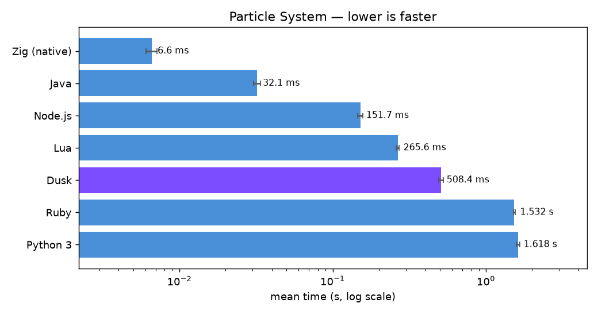

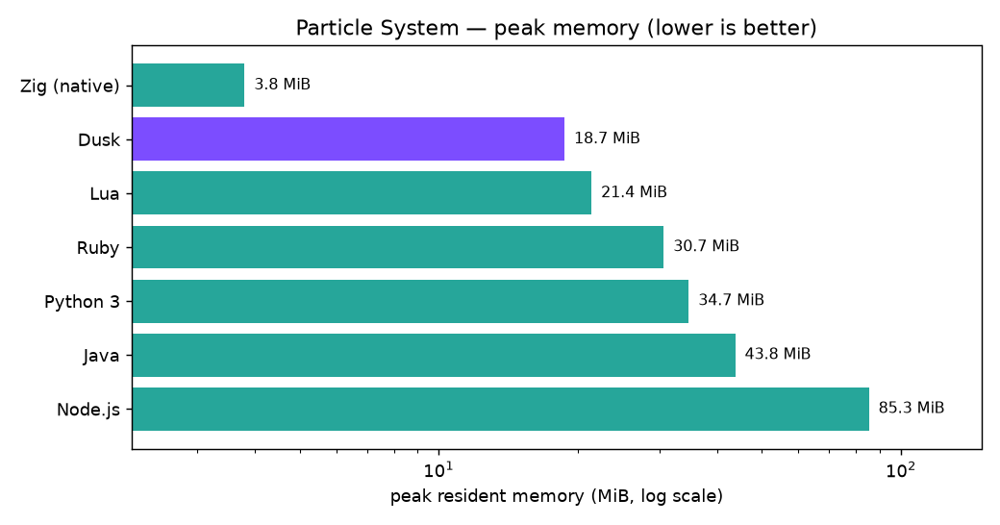

### Sieve of Eratosthenes (`primes`)

Count primes up to 100,000 using a contiguous boolean array.

Expected output: `9592`

| Language | Mean | Std dev | Min | Max | Relative | Peak mem |
| --- | --- | --- | --- | --- | --- | --- |
| Zig (native) | 729.7 µs | 61.4 µs | 591.8 µs | 917.4 µs | 1.00× | 0.8 MiB |
| Lua | 5.3 ms | 205.3 µs | 4.9 ms | 5.9 ms | 7.24× | 4.8 MiB |
| **Dusk** | **9.1 ms** | **482.5 µs** | **8.3 ms** | **14.2 ms** | **12.48×** | **4.8 MiB** |
| Java | 16.4 ms | 526.2 µs | 15.7 ms | 18.7 ms | 22.50× | 38.3 MiB |
| Python 3 | 23.9 ms | 1.6 ms | 22.3 ms | 32.8 ms | 32.80× | 9.9 MiB |
| Ruby | 47.6 ms | 2.4 ms | 45.0 ms | 55.8 ms | 65.17× | 15.2 MiB |
| Node.js | 74.8 ms | 1.5 ms | 72.2 ms | 80.3 ms | 102.44× | 59.7 MiB |

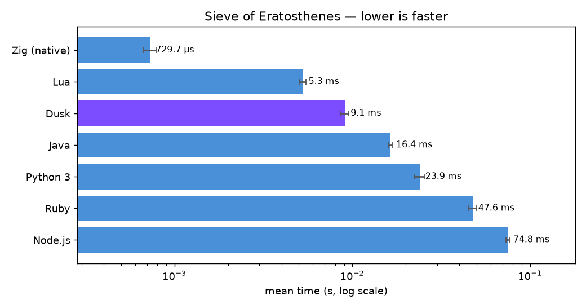

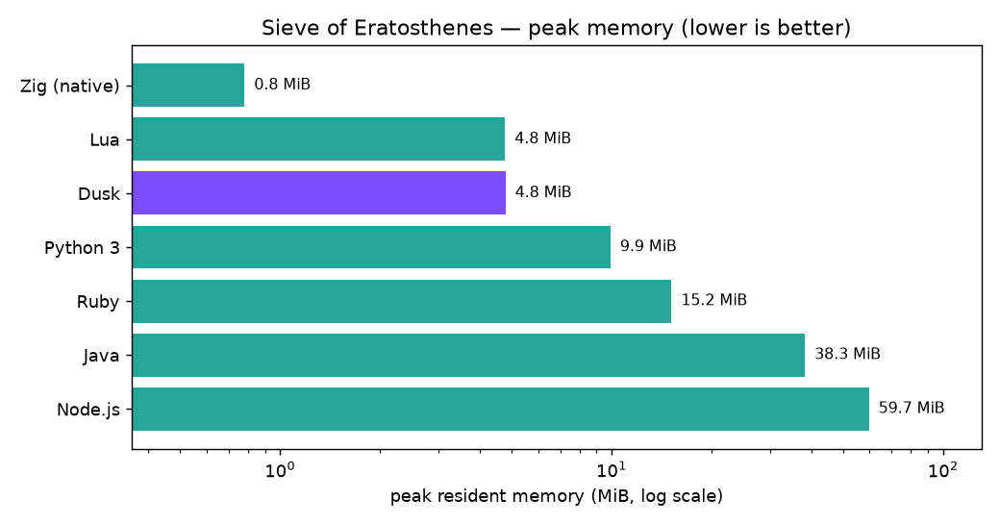

### QuickSort (`quicksort`)

Sort 10,000 descending ints in place with a hand-written, recursive middle-pivot quicksort; print value at index 5000.

Expected output: `5001`

| Language | Mean | Std dev | Min | Max | Relative | Peak mem |
| --- | --- | --- | --- | --- | --- | --- |
| Zig (native) | 685.0 µs | 83.1 µs | 541.4 µs | 2.4 ms | 1.00× | 0.7 MiB |
| Lua | 3.0 ms | 99.5 µs | 2.8 ms | 4.4 ms | 4.38× | 3.1 MiB |
| **Dusk** | **5.0 ms** | **164.1 µs** | **4.6 ms** | **5.6 ms** | **7.31×** | **3.2 MiB** |
| Python 3 | 14.5 ms | 280.9 µs | 14.0 ms | 15.5 ms | 21.10× | 9.5 MiB |
| Java | 15.9 ms | 559.0 µs | 14.9 ms | 18.1 ms | 23.25× | 38.3 MiB |
| Ruby | 41.1 ms | 944.7 µs | 40.2 ms | 45.7 ms | 59.97× | 14.4 MiB |
| Node.js | 72.3 ms | 962.7 µs | 70.7 ms | 74.4 ms | 105.60× | 58.9 MiB |

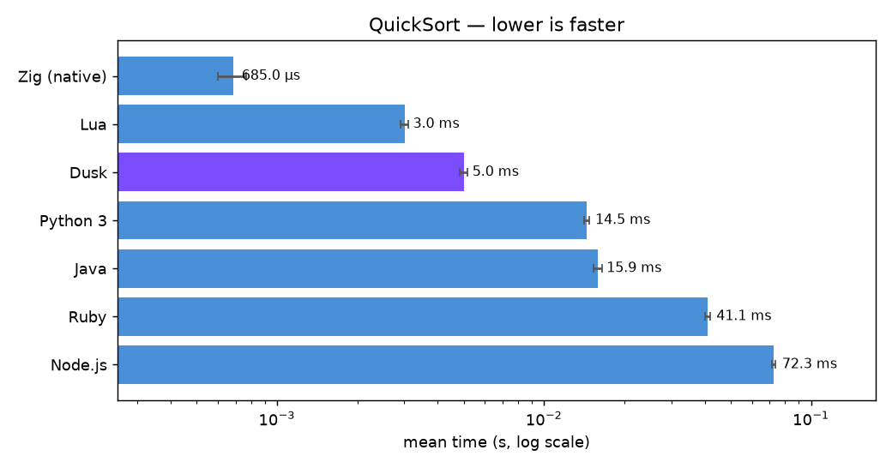

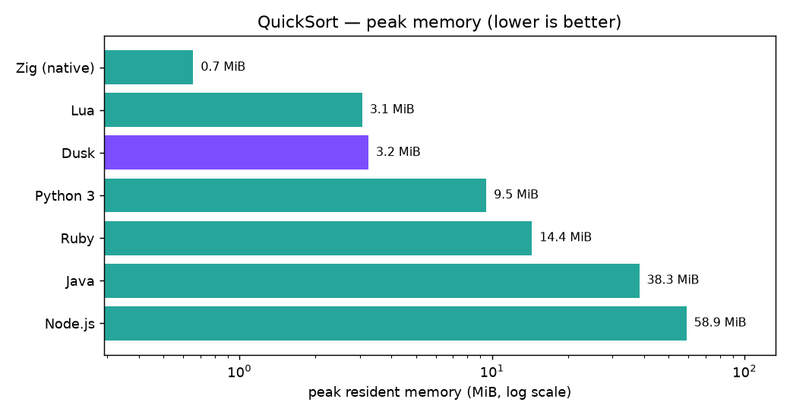

### Mandelbrot (`mandelbrot`)

800x800 grid, up to 1000 iterations per pixel (identical IEEE-754 double math everywhere); print the sum of all iteration counts as a checksum.

Expected output: `141554306`

| Language | Mean | Std dev | Min | Max | Relative | Peak mem |
| --- | --- | --- | --- | --- | --- | --- |
| Zig (native) | 308.7 ms | 1.1 ms | 306.6 ms | 309.8 ms | 1.00× | 0.7 MiB |
| Java | 335.1 ms | 3.6 ms | 330.6 ms | 342.6 ms | 1.09× | 38.7 MiB |
| Node.js | 400.7 ms | 5.8 ms | 392.9 ms | 409.1 ms | 1.30× | 60.9 MiB |
| Lua | 4.384 s | 71.1 ms | 4.284 s | 4.471 s | 14.20× | 2.8 MiB |
| **Dusk** | **9.464 s** | **690.2 ms** | **9.082 s** | **10.690 s** | **30.66×** | **3.2 MiB** |
| Ruby | 9.765 s | 62.6 ms | 9.662 s | 9.834 s | 31.63× | 14.3 MiB |
| Python 3 | 40.941 s | 3.882 s | 38.254 s | 47.701 s | 132.63× | 9.3 MiB |

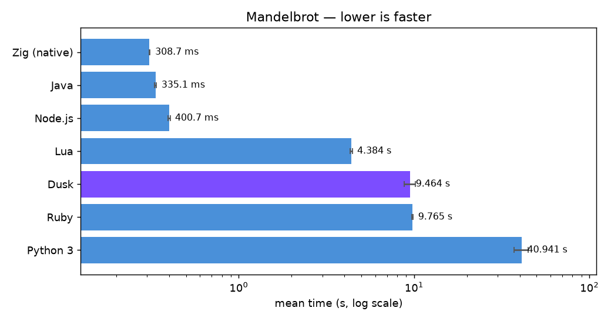


### Strings (`strings`)

1,000,000 iterations of: build "item {i}: value={i*3} tag={name}" by interpolation, split it on spaces, join the pieces with commas; print the sum of the line, piece-count and joined lengths.

Expected output: `73037032`

| Language | Mean | Std dev | Min | Max | Relative | Peak mem |
| --- | --- | --- | --- | --- | --- | --- |
| Zig (native) | 87.2 ms | 2.9 ms | 84.8 ms | 99.7 ms | 1.00× | 0.7 MiB |
| **Dusk** | **278.7 ms** | **2.4 ms** | **275.1 ms** | **283.1 ms** | **3.20×** | **5.1 MiB** |
| Java | 312.2 ms | 8.2 ms | 302.1 ms | 324.1 ms | 3.58× | 285.8 MiB |
| Node.js | 432.3 ms | 1.5 ms | 430.3 ms | 434.8 ms | 4.96× | 91.2 MiB |
| Python 3 | 571.2 ms | 9.5 ms | 556.0 ms | 580.7 ms | 6.55× | 9.0 MiB |
| Ruby | 913.8 ms | 6.7 ms | 907.6 ms | 924.3 ms | 10.48× | 14.3 MiB |
| Lua | 1.134 s | 15.5 ms | 1.111 s | 1.154 s | 13.00× | 2.8 MiB |

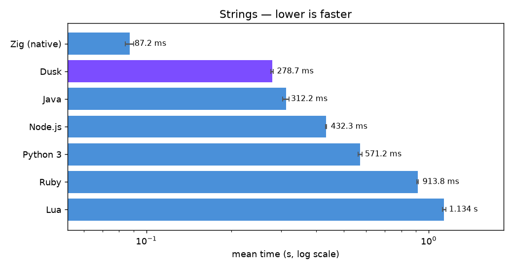

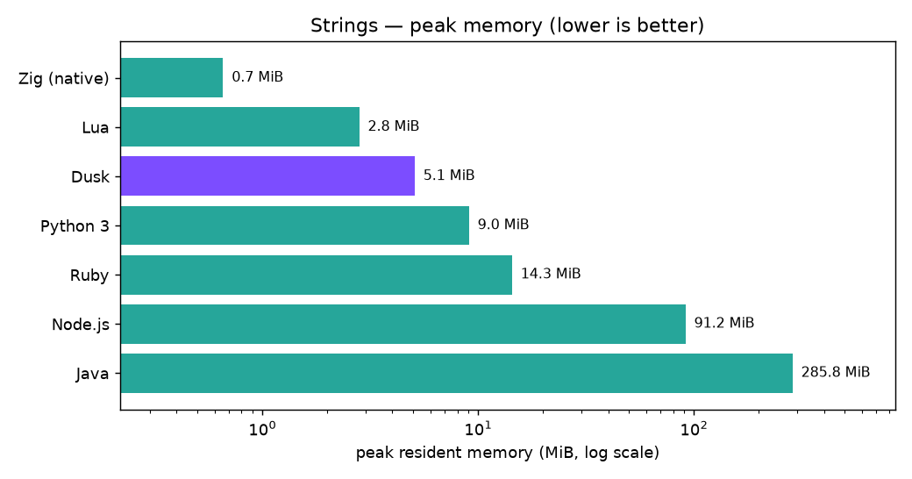

### String Concatenation (`concat`)

Grow a string by appending "ab" 200,000 times with plain concatenation (no builder), so every step copies the whole string; print the final length.

Expected output: `400000`

| Language | Mean | Std dev | Min | Max | Relative | Peak mem |
| --- | --- | --- | --- | --- | --- | --- |
| Node.js | 87.6 ms | 1.2 ms | 85.5 ms | 91.6 ms | 0.14× | 70.6 MiB |
| Zig (native) | 640.2 ms | 4.8 ms | 635.1 ms | 647.0 ms | 1.00× | 1.2 MiB |
| **Dusk** | **1.111 s** | **14.6 ms** | **1.101 s** | **1.137 s** | **1.74×** | **5.2 MiB** |
| Java | 3.256 s | 13.7 ms | 3.240 s | 3.273 s | 5.09× | 717.1 MiB |
| Ruby | 3.286 s | 84.7 ms | 3.201 s | 3.374 s | 5.13× | 78.5 MiB |
| Python 3 | 3.323 s | 31.0 ms | 3.295 s | 3.362 s | 5.19× | 10.1 MiB |
| Lua | 4.752 s | 34.0 ms | 4.705 s | 4.798 s | 7.42× | 5.0 MiB |

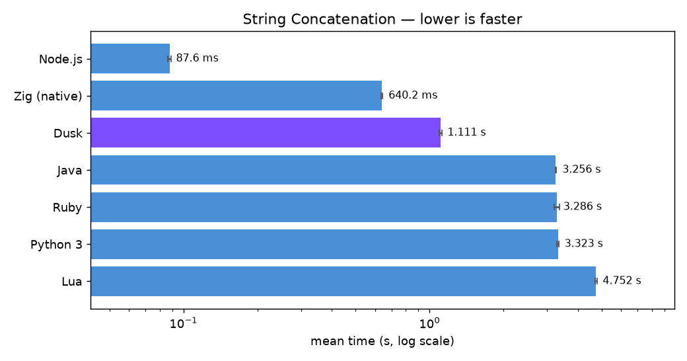

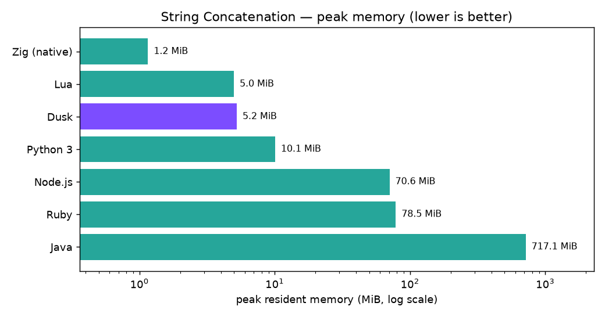

### CSV Parsing (`parse`)

Build 500,000 "i,(i*7)%1000,item{i}" rows, join them with newlines, then split the text back into rows and fields and parse the first two fields as ints; print their sum plus the row count.

Expected output: `125250000000`

| Language | Mean | Std dev | Min | Max | Relative | Peak mem |
| --- | --- | --- | --- | --- | --- | --- |
| Zig (native) | 52.3 ms | 656.2 µs | 51.4 ms | 54.3 ms | 1.00× | 49.5 MiB |
| Java | 228.3 ms | 3.6 ms | 219.6 ms | 233.3 ms | 4.36× | 260.4 MiB |
| Node.js | 331.4 ms | 4.4 ms | 324.3 ms | 337.8 ms | 6.33× | 208.5 MiB |
| Python 3 | 347.1 ms | 5.8 ms | 338.7 ms | 354.2 ms | 6.63× | 88.4 MiB |
| **Dusk** | **412.5 ms** | **4.7 ms** | **406.4 ms** | **419.0 ms** | **7.88×** | **234.4 MiB** |
| Lua | 487.7 ms | 5.1 ms | 480.3 ms | 493.5 ms | 9.32× | 82.1 MiB |
| Ruby | 557.5 ms | 12.1 ms | 544.4 ms | 569.2 ms | 10.65× | 140.4 MiB |

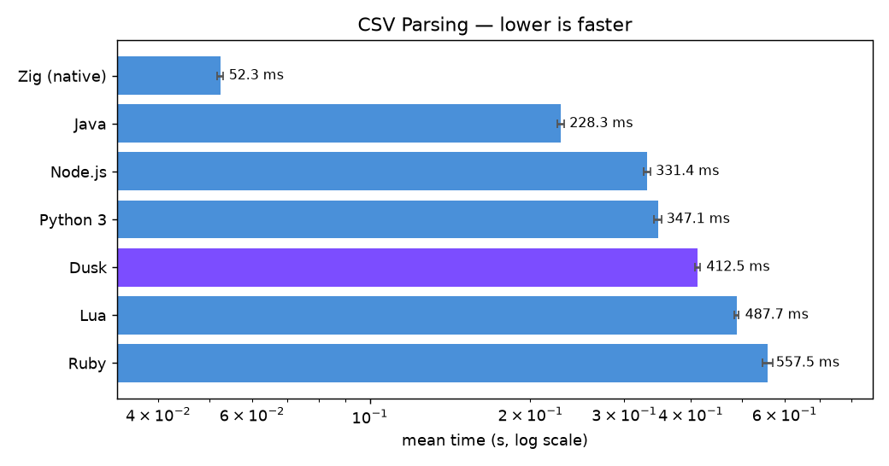

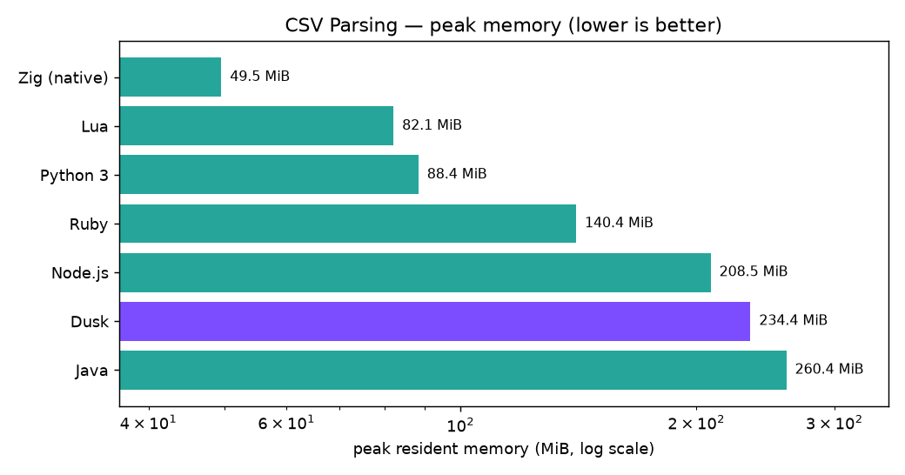

## Time summary

Slowdown of each language relative to the **Zig (native)** baseline in each benchmark (log scale).

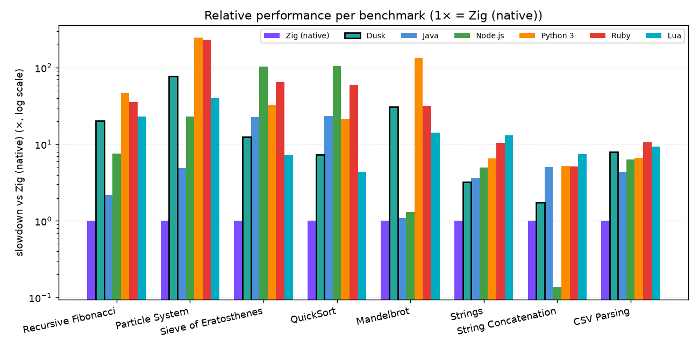

## Memory summary

Peak resident memory per benchmark (log scale).

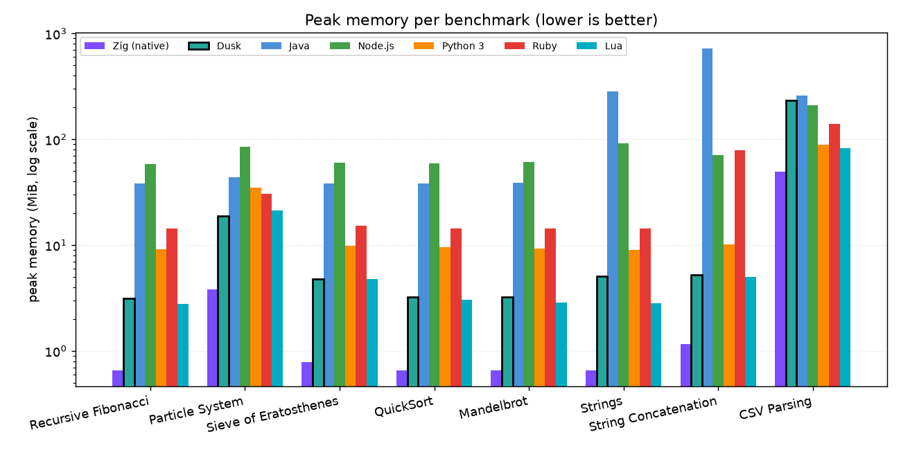
