# Benchmark

Cross-language micro-benchmarks tracking **Dusk** against a native **Zig** baseline and five mainstream runtimes. Wall time is measured externally with [`hyperfine`](https://github.com/sharkdp/hyperfine) and peak memory with GNU `/usr/bin/time`; the benchmark programs contain **no timing or instrumentation code**.
> This benchmark is not evidence that X is faster than Y, its main purpose is to track Dusk performance specially on versions change, so we can notice performance problems/gains.

Regenerate this file with:

```bash
python3 run_benchmarks.py
```

> **Note:** This benchmark generation script and the algorithms were AI-generated. I haven't deeply reviewed them, so they may contain errors.

## Machine

| Field | Value |
| --- | --- |
| OS | Fedora Linux 44 (Workstation Edition) |
| Kernel | Linux 7.2.13-200.fc44.x86_64 |
| Architecture | x86_64 |
| CPU | AMD Ryzen 5 5600X 6-Core Processor |
| Cores / Threads | 6 cores / 12 threads |
| CPU max | 4.65 GHz |
| Memory | 31.2 GiB total |
| Date | 2026-11-08 06:55 UTC |

## Language toolchains

| Language | Version / mode |
| --- | --- |
| **Dusk** | **0.14.0 (git 827ef83) — built with Zig 0.16.0, ReleaseFast** |
| Zig (native) | 0.16.0 — native baseline, build-exe -OReleaseFast |
| Java | openjdk version 25.0.4.1 2026-08-18 — precompiled with javac, JVM startup included |
| Node.js | v22.23.1 |
| Python 3 | Python 3.14.8 |
| Ruby | ruby 4.0.7 (2026-09-15 revision 229531a6cf) +PRISM |
| Lua | Lua 5.4.8  Copyright (C) 1994-2025 Lua.org, PUC-Rio |
| hyperfine | hyperfine 1.20.0 |

## Methodology

- Wall time is sampled by hyperfine with `--warmup 2 --min-runs 5 -N` (no intermediate shell).
- Peak memory is the resident-set high-water mark from `/usr/bin/time -f %M`, reported as the **median of 3 runs**. It includes the runtime/interpreter footprint (JVM, V8, CPython, the Dusk VM, …) plus the workload.
- **Zig (native)** is the baseline: compiled with `zig build-exe -OReleaseFast`. The **Relative** column and the summary charts are normalised to it (Zig = 1.00×, i.e. "× slower than native").
- No external libraries are used by any benchmark program.
- Every program is verified to print the expected result before measuring.

## Results

### Recursive Fibonacci (`fib`)

Compute fib(35) with pure recursion (fib(n-1) + fib(n-2)).

Expected output: `9227465`

| Language | Mean | Std dev | Min | Max | Relative | Peak mem |
| --- | --- | --- | --- | --- | --- | --- |
| Zig (native) | 20.2 ms | 504.7 µs | 19.3 ms | 22.4 ms | 1.00× | 0.7 MiB |
| Java | 48.1 ms | 3.6 ms | 44.6 ms | 69.2 ms | 2.38× | 38.2 MiB |
| Node.js | 161.4 ms | 7.5 ms | 149.4 ms | 180.8 ms | 7.98× | 58.7 MiB |
| **Dusk** | **434.7 ms** | **7.5 ms** | **426.4 ms** | **443.9 ms** | **21.50×** | **1.7 MiB** |
| Lua | 503.3 ms | 12.0 ms | 489.0 ms | 516.9 ms | 24.88× | 2.9 MiB |
| Ruby | 702.9 ms | 23.8 ms | 678.8 ms | 742.4 ms | 34.75× | 14.4 MiB |
| Python 3 | 940.9 ms | 34.5 ms | 903.9 ms | 990.9 ms | 46.52× | 9.2 MiB |

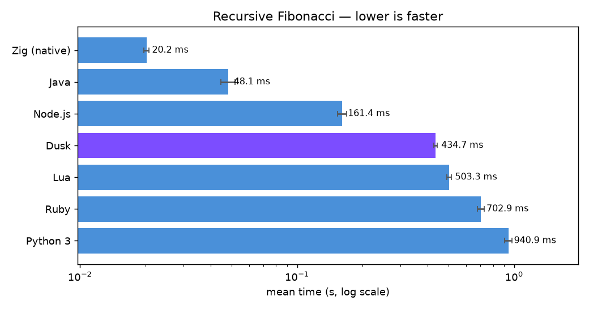

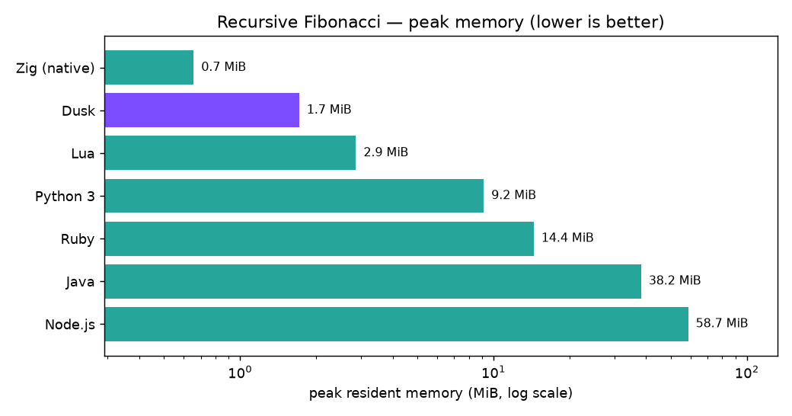

### Particle System (`particles`)

100,000 particles, 100 update passes of x += vx / y += vy; print x of the 50,000th particle.

Expected output: `50049`

| Language | Mean | Std dev | Min | Max | Relative | Peak mem |
| --- | --- | --- | --- | --- | --- | --- |
| Zig (native) | 6.8 ms | 595.7 µs | 5.8 ms | 9.0 ms | 1.00× | 3.8 MiB |
| Java | 36.7 ms | 2.8 ms | 31.9 ms | 53.0 ms | 5.40× | 43.8 MiB |
| Node.js | 168.4 ms | 8.8 ms | 160.1 ms | 196.8 ms | 24.73× | 85.2 MiB |
| Lua | 272.8 ms | 7.1 ms | 259.6 ms | 282.5 ms | 40.06× | 21.8 MiB |
| **Dusk** | **889.1 ms** | **74.8 ms** | **799.6 ms** | **969.2 ms** | **130.55×** | **17.1 MiB** |
| Ruby | 1.544 s | 22.9 ms | 1.514 s | 1.578 s | 226.79× | 30.9 MiB |
| Python 3 | 1.611 s | 19.2 ms | 1.580 s | 1.632 s | 236.57× | 34.7 MiB |

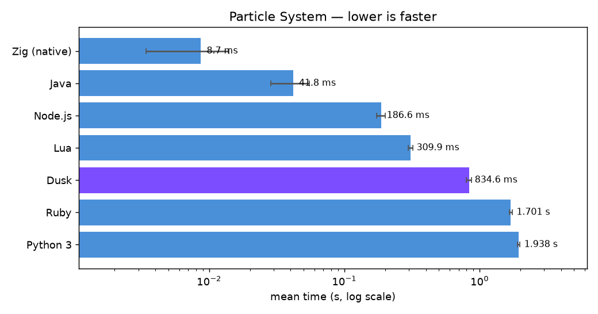

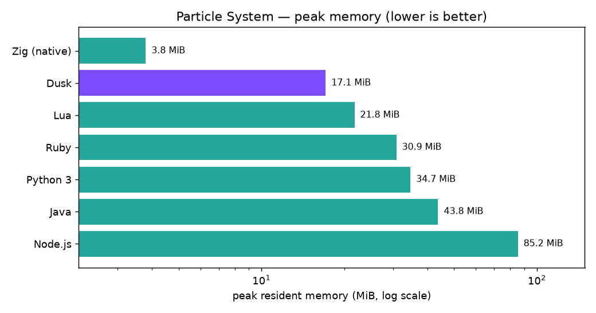

### Sieve of Eratosthenes (`primes`)

Count primes up to 100,000 using a contiguous boolean array.

Expected output: `9592`

| Language | Mean | Std dev | Min | Max | Relative | Peak mem |
| --- | --- | --- | --- | --- | --- | --- |
| Zig (native) | 774.0 µs | 163.7 µs | 609.7 µs | 2.0 ms | 1.00× | 0.8 MiB |
| Lua | 5.7 ms | 520.3 µs | 4.9 ms | 8.5 ms | 7.40× | 4.7 MiB |
| **Dusk** | **10.9 ms** | **587.3 µs** | **10.0 ms** | **12.8 ms** | **14.14×** | **3.2 MiB** |
| Java | 18.3 ms | 1.1 ms | 16.6 ms | 24.5 ms | 23.69× | 38.1 MiB |
| Python 3 | 25.4 ms | 2.0 ms | 22.9 ms | 36.6 ms | 32.88× | 10.0 MiB |
| Ruby | 51.1 ms | 3.6 ms | 47.5 ms | 68.3 ms | 66.04× | 15.2 MiB |
| Node.js | 82.5 ms | 4.5 ms | 76.0 ms | 101.1 ms | 106.56× | 59.5 MiB |

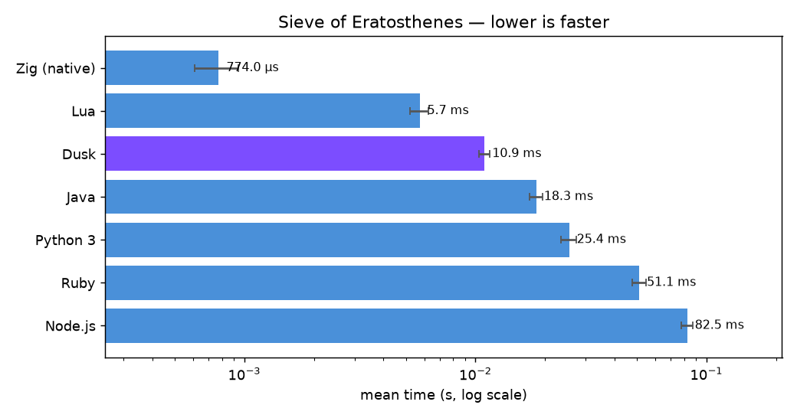

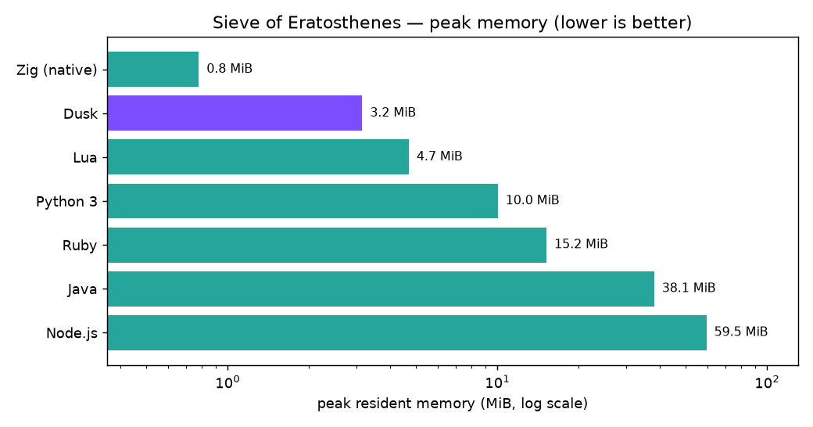

### QuickSort (`quicksort`)

Sort 10,000 descending ints in place with a hand-written, recursive middle-pivot quicksort; print value at index 5000.

Expected output: `5001`

| Language | Mean | Std dev | Min | Max | Relative | Peak mem |
| --- | --- | --- | --- | --- | --- | --- |
| Zig (native) | 727.0 µs | 206.1 µs | 556.7 µs | 2.0 ms | 1.00× | 0.7 MiB |
| Lua | 3.2 ms | 386.5 µs | 2.8 ms | 5.5 ms | 4.43× | 3.1 MiB |
| **Dusk** | **5.8 ms** | **585.0 µs** | **5.2 ms** | **10.5 ms** | **8.03×** | **1.7 MiB** |
| Python 3 | 16.0 ms | 761.7 µs | 14.6 ms | 19.2 ms | 22.02× | 9.7 MiB |
| Java | 19.0 ms | 1.7 ms | 16.6 ms | 27.4 ms | 26.12× | 38.1 MiB |
| Ruby | 46.5 ms | 1.3 ms | 43.9 ms | 50.2 ms | 64.01× | 14.7 MiB |
| Node.js | 83.7 ms | 3.6 ms | 76.0 ms | 89.5 ms | 115.12× | 58.8 MiB |

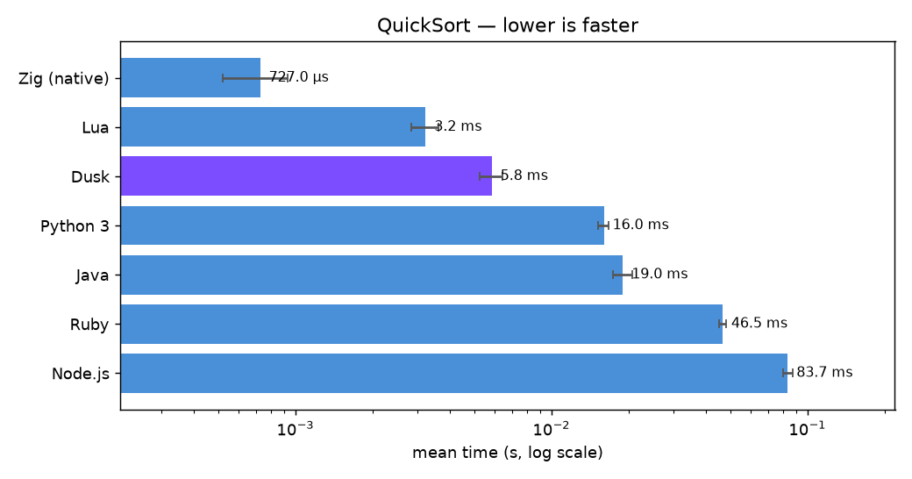

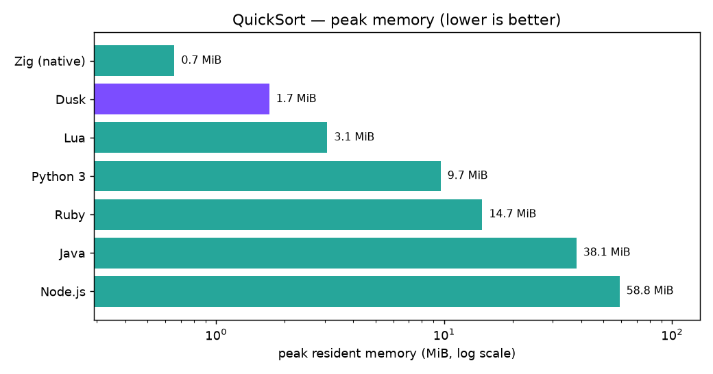

### Mandelbrot (`mandelbrot`)

800x800 grid, up to 1000 iterations per pixel (identical IEEE-754 double math everywhere); print the sum of all iteration counts as a checksum.

Expected output: `141554306`

| Language | Mean | Std dev | Min | Max | Relative | Peak mem |
| --- | --- | --- | --- | --- | --- | --- |
| Zig (native) | 313.7 ms | 1.1 ms | 312.2 ms | 316.1 ms | 1.00× | 0.7 MiB |
| Java | 338.2 ms | 945.0 µs | 336.7 ms | 339.5 ms | 1.08× | 38.6 MiB |
| Node.js | 399.3 ms | 5.1 ms | 394.2 ms | 408.8 ms | 1.27× | 60.8 MiB |
| Lua | 4.379 s | 75.0 ms | 4.250 s | 4.435 s | 13.96× | 3.0 MiB |
| Ruby | 10.053 s | 131.6 ms | 9.923 s | 10.220 s | 32.05× | 14.5 MiB |
| **Dusk** | **10.703 s** | **186.5 ms** | **10.508 s** | **10.983 s** | **34.12×** | **1.7 MiB** |
| Python 3 | 39.843 s | 2.531 s | 37.275 s | 42.692 s | 127.01× | 9.4 MiB |

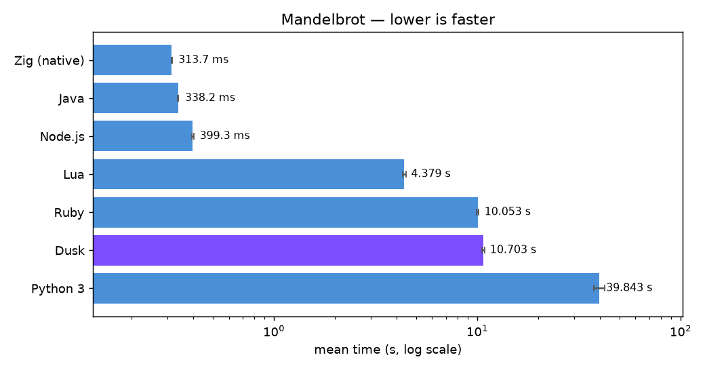

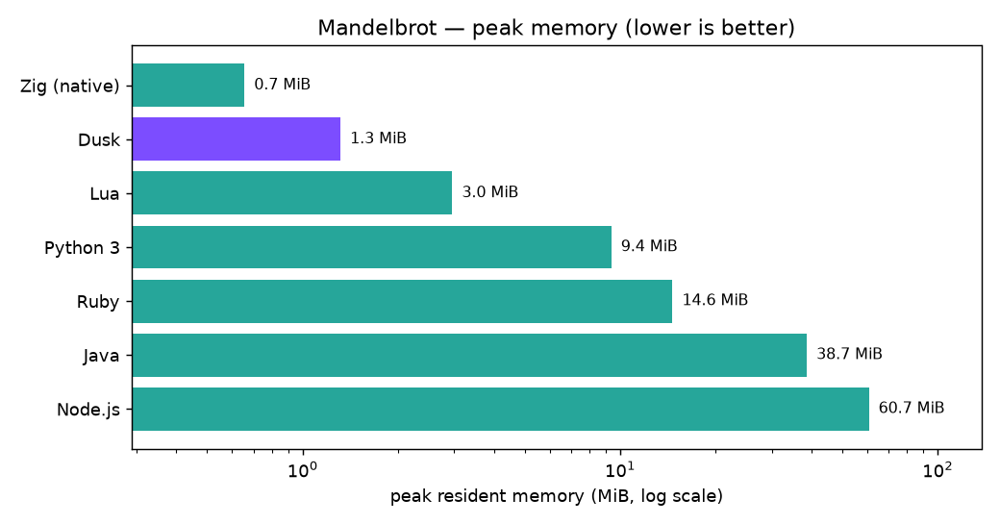

### Strings (`strings`)

1,000,000 iterations of: build "item {i}: value={i*3} tag={name}" by interpolation, split it on spaces, join the pieces with commas; print the sum of the line, piece-count and joined lengths.

Expected output: `73037032`

| Language | Mean | Std dev | Min | Max | Relative | Peak mem |
| --- | --- | --- | --- | --- | --- | --- |
| Zig (native) | 88.7 ms | 2.2 ms | 85.5 ms | 92.0 ms | 1.00× | 0.7 MiB |
| **Dusk** | **268.2 ms** | **2.6 ms** | **262.7 ms** | **271.3 ms** | **3.02×** | **3.3 MiB** |
| Java | 314.7 ms | 6.4 ms | 307.2 ms | 325.3 ms | 3.55× | 286.4 MiB |
| Node.js | 455.5 ms | 7.1 ms | 448.6 ms | 466.7 ms | 5.13× | 91.0 MiB |
| Python 3 | 585.0 ms | 14.3 ms | 572.0 ms | 608.1 ms | 6.60× | 9.0 MiB |
| Ruby | 904.7 ms | 4.9 ms | 899.9 ms | 912.9 ms | 10.20× | 14.6 MiB |
| Lua | 1.147 s | 18.8 ms | 1.122 s | 1.171 s | 12.93× | 2.7 MiB |

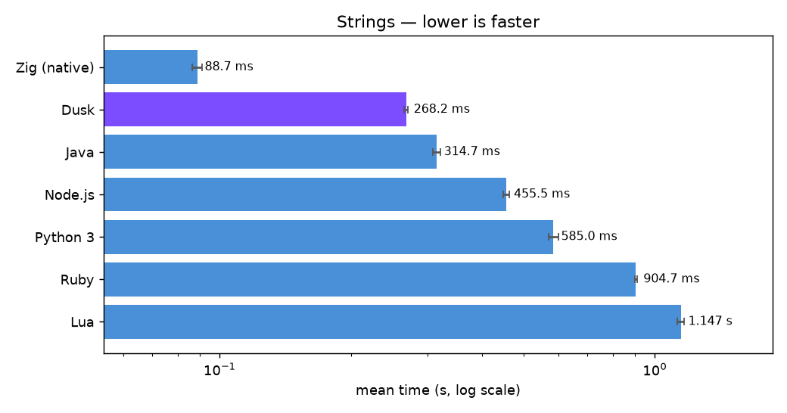

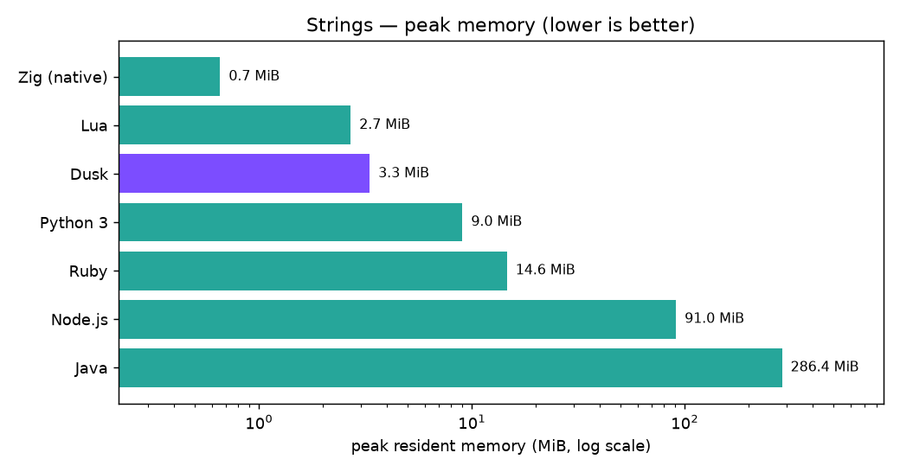

### String Concatenation (`concat`)

Grow a string by appending "ab" 200,000 times with plain concatenation (no builder), so every step copies the whole string; print the final length.

Expected output: `400000`

| Language | Mean | Std dev | Min | Max | Relative | Peak mem |
| --- | --- | --- | --- | --- | --- | --- |
| Node.js | 94.5 ms | 10.5 ms | 88.6 ms | 138.1 ms | 0.14× | 70.9 MiB |
| Zig (native) | 664.8 ms | 10.1 ms | 654.9 ms | 680.6 ms | 1.00× | 1.2 MiB |
| **Dusk** | **1.144 s** | **17.5 ms** | **1.122 s** | **1.171 s** | **1.72×** | **3.6 MiB** |
| Java | 3.400 s | 95.0 ms | 3.296 s | 3.528 s | 5.11× | 568.9 MiB |
| Python 3 | 3.487 s | 78.7 ms | 3.413 s | 3.582 s | 5.25× | 10.2 MiB |
| Ruby | 3.700 s | 87.7 ms | 3.551 s | 3.759 s | 5.57× | 78.9 MiB |
| Lua | 4.929 s | 82.0 ms | 4.848 s | 5.066 s | 7.41× | 4.9 MiB |

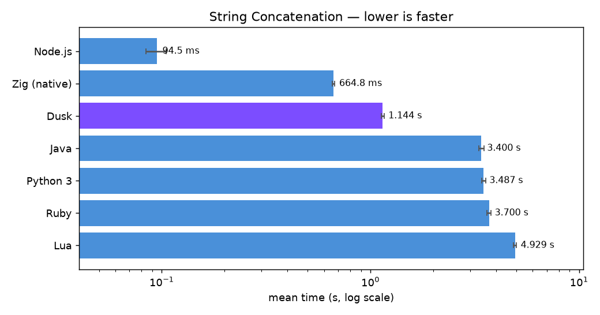

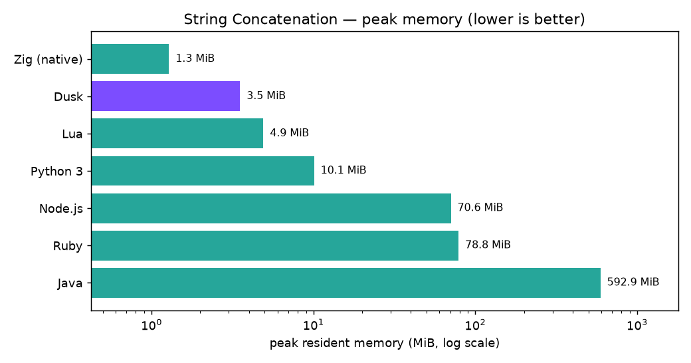

### CSV Parsing (`parse`)

Build 500,000 "i,(i*7)%1000,item{i}" rows, join them with newlines, then split the text back into rows and fields and parse the first two fields as ints; print their sum plus the row count.

Expected output: `125250000000`

| Language | Mean | Std dev | Min | Max | Relative | Peak mem |
| --- | --- | --- | --- | --- | --- | --- |
| Zig (native) | 53.3 ms | 837.5 µs | 51.9 ms | 56.7 ms | 1.00× | 49.7 MiB |
| Java | 238.1 ms | 5.6 ms | 226.4 ms | 249.2 ms | 4.47× | 259.6 MiB |
| Node.js | 339.0 ms | 12.1 ms | 329.7 ms | 364.1 ms | 6.36× | 205.9 MiB |
| Python 3 | 360.8 ms | 10.0 ms | 348.9 ms | 381.8 ms | 6.77× | 88.5 MiB |
| **Dusk** | **413.0 ms** | **4.4 ms** | **409.0 ms** | **422.3 ms** | **7.75×** | **232.8 MiB** |
| Lua | 547.8 ms | 25.0 ms | 516.4 ms | 579.6 ms | 10.28× | 82.1 MiB |
| Ruby | 564.2 ms | 9.3 ms | 550.6 ms | 574.3 ms | 10.59× | 124.7 MiB |

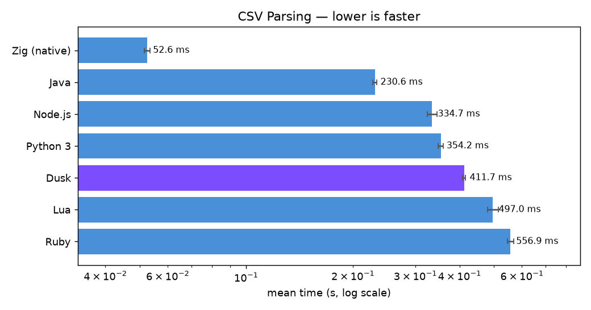

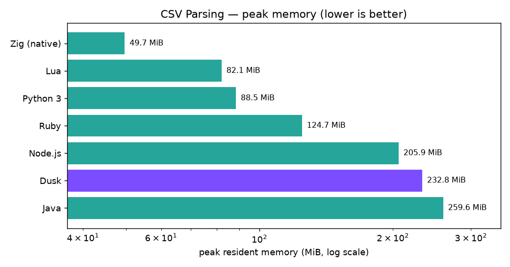

## Time summary

Slowdown of each language relative to the **Zig (native)** baseline in each benchmark (log scale).

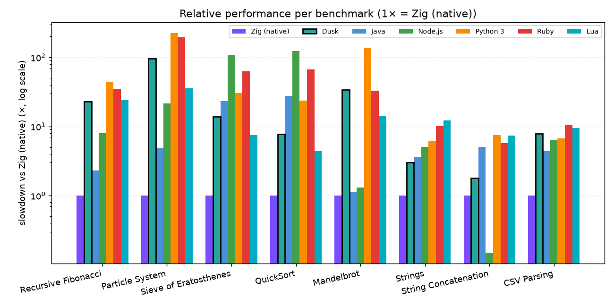

## Memory summary

Peak resident memory per benchmark (log scale).

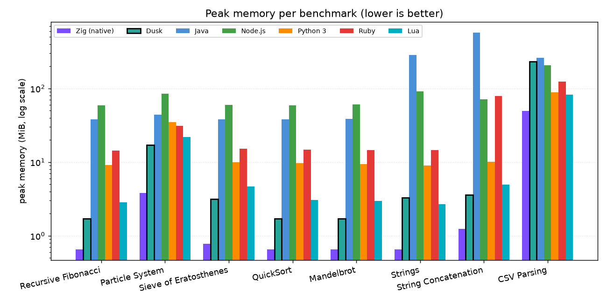
