# Benchmark

Cross-language micro-benchmarks tracking **Dusk** against a native **Zig** baseline and five mainstream runtimes. Wall time is measured externally with [`hyperfine`](https://github.com/sharkdp/hyperfine) and peak memory with GNU `/usr/bin/time`; the benchmark programs contain **no timing or instrumentation code**.
> This benchmark is not evidence that X is faster than Y, its main purpose is to track Dusk performance specially on versions change, so we can notice performance problems/gains.

Regenerate this file with:

```bash
python3 run_benchmarks.py
```

> **Note:** This benchmark generation script and the algorithms were AI-generated. I haven't deeply reviewed them, so they may contain errors.

## Machine

| Field | Value |
| --- | --- |
| OS | Fedora Linux 44 (Workstation Edition) |
| Kernel | Linux 7.2.10-200.fc44.x86_64 |
| Architecture | x86_64 |
| CPU | AMD Ryzen 5 5600X 6-Core Processor |
| Cores / Threads | 6 cores / 12 threads |
| CPU max | 4.65 GHz |
| Memory | 31.2 GiB total |
| Date | 2026-10-25 19:48 UTC |

## Language toolchains

| Language | Version / mode |
| --- | --- |
| **Dusk** | **0.11.0-devel (git 66c9cb8) — built with Zig 0.16.0, ReleaseFast** |
| Zig (native) | 0.16.0 — native baseline, build-exe -OReleaseFast |
| Java | openjdk version 25.0.4.1 2026-08-18 — precompiled with javac, JVM startup included |
| Node.js | v22.23.1 |
| Python 3 | Python 3.14.8 |
| Ruby | ruby 4.0.7 (2026-09-15 revision 229531a6cf) +PRISM |
| Lua | Lua 5.4.8  Copyright (C) 1994-2025 Lua.org, PUC-Rio |
| hyperfine | hyperfine 1.20.0 |

## Methodology

- Wall time is sampled by hyperfine with `--warmup 2 --min-runs 5 -N` (no intermediate shell).
- Peak memory is the resident-set high-water mark from `/usr/bin/time -f %M`, reported as the **median of 3 runs**. It includes the runtime/interpreter footprint (JVM, V8, CPython, the Dusk VM, …) plus the workload.
- **Zig (native)** is the baseline: compiled with `zig build-exe -OReleaseFast`. The **Relative** column and the summary charts are normalised to it (Zig = 1.00×, i.e. "× slower than native").
- No external libraries are used by any benchmark program.
- Every program is verified to print the expected result before measuring.

## Results

### Recursive Fibonacci (`fib`)

Compute fib(35) with pure recursion (fib(n-1) + fib(n-2)).

Expected output: `9227465`

| Language | Mean | Std dev | Min | Max | Relative | Peak mem |
| --- | --- | --- | --- | --- | --- | --- |
| Zig (native) | 19.1 ms | 191.9 µs | 18.9 ms | 20.1 ms | 1.00× | 0.7 MiB |
| Java | 42.0 ms | 808.2 µs | 40.2 ms | 43.3 ms | 2.20× | 38.3 MiB |
| Node.js | 144.3 ms | 975.1 µs | 142.6 ms | 146.0 ms | 7.56× | 58.5 MiB |
| **Dusk** | **413.3 ms** | **5.0 ms** | **407.9 ms** | **423.4 ms** | **21.66×** | **1.2 MiB** |
| Lua | 452.2 ms | 6.5 ms | 443.8 ms | 459.0 ms | 23.70× | 2.7 MiB |
| Ruby | 686.9 ms | 15.5 ms | 678.5 ms | 714.5 ms | 36.00× | 14.8 MiB |
| Python 3 | 905.2 ms | 36.2 ms | 858.5 ms | 958.8 ms | 47.44× | 9.4 MiB |

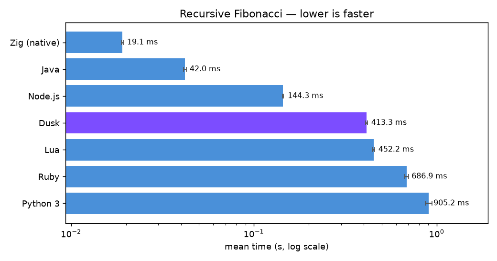


### Particle System (`particles`)

100,000 particles, 100 update passes of x += vx / y += vy; print x of the 50,000th particle.

Expected output: `50049`

| Language | Mean | Std dev | Min | Max | Relative | Peak mem |
| --- | --- | --- | --- | --- | --- | --- |
| Zig (native) | 6.1 ms | 225.2 µs | 5.6 ms | 7.1 ms | 1.00× | 3.8 MiB |
| Java | 31.7 ms | 1.3 ms | 30.0 ms | 36.3 ms | 5.19× | 44.2 MiB |
| Node.js | 147.7 ms | 1.2 ms | 145.4 ms | 149.9 ms | 24.16× | 85.3 MiB |
| Lua | 261.9 ms | 4.4 ms | 254.2 ms | 270.2 ms | 42.86× | 21.6 MiB |
| **Dusk** | **459.3 ms** | **20.6 ms** | **422.5 ms** | **483.9 ms** | **75.16×** | **17.0 MiB** |
| Ruby | 1.458 s | 17.5 ms | 1.438 s | 1.481 s | 238.57× | 30.8 MiB |
| Python 3 | 1.681 s | 103.7 ms | 1.571 s | 1.803 s | 275.06× | 34.9 MiB |

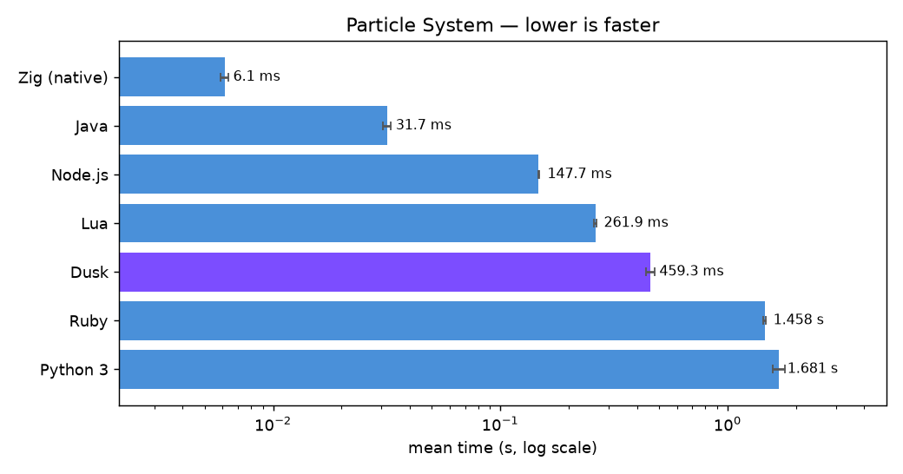

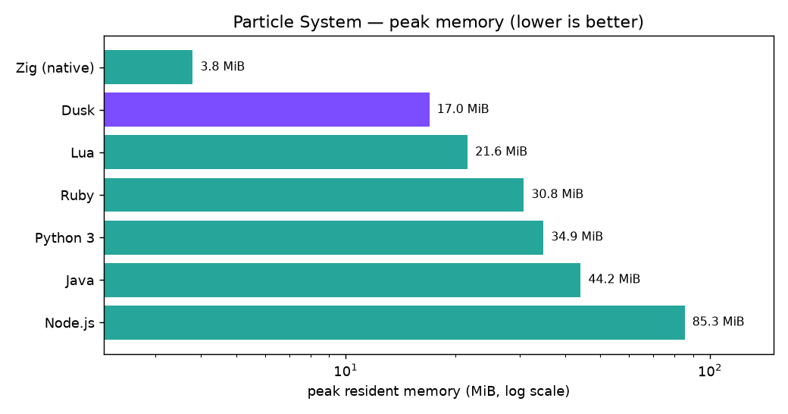

### Sieve of Eratosthenes (`primes`)

Count primes up to 100,000 using a contiguous boolean array.

Expected output: `9592`

| Language | Mean | Std dev | Min | Max | Relative | Peak mem |
| --- | --- | --- | --- | --- | --- | --- |
| Zig (native) | 719.9 µs | 54.9 µs | 579.7 µs | 901.8 µs | 1.00× | 0.8 MiB |
| Lua | 5.3 ms | 203.3 µs | 4.8 ms | 5.9 ms | 7.30× | 4.8 MiB |
| **Dusk** | **9.0 ms** | **368.8 µs** | **8.1 ms** | **10.8 ms** | **12.51×** | **3.0 MiB** |
| Java | 16.4 ms | 361.5 µs | 15.9 ms | 17.6 ms | 22.83× | 38.1 MiB |
| Python 3 | 22.3 ms | 655.7 µs | 21.3 ms | 25.6 ms | 31.04× | 10.1 MiB |
| Ruby | 44.4 ms | 527.3 µs | 43.6 ms | 46.8 ms | 61.73× | 15.3 MiB |
| Node.js | 73.1 ms | 820.1 µs | 71.4 ms | 74.9 ms | 101.53× | 59.7 MiB |

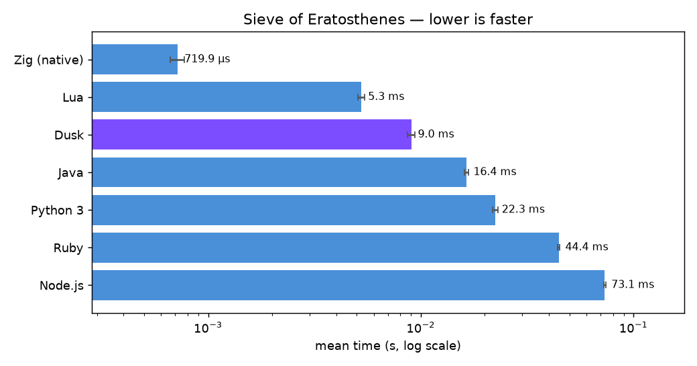

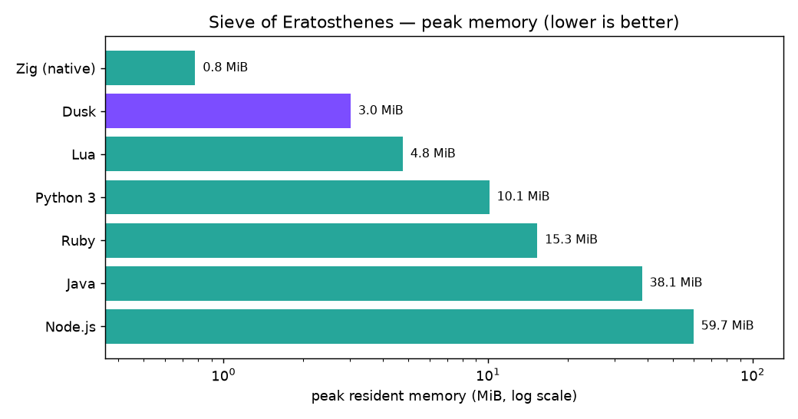

### QuickSort (`quicksort`)

Sort 10,000 descending ints in place with a hand-written, recursive middle-pivot quicksort; print value at index 5000.

Expected output: `5001`

| Language | Mean | Std dev | Min | Max | Relative | Peak mem |
| --- | --- | --- | --- | --- | --- | --- |
| Zig (native) | 651.1 µs | 54.0 µs | 534.1 µs | 818.2 µs | 1.00× | 0.8 MiB |
| Lua | 3.0 ms | 84.1 µs | 2.7 ms | 3.3 ms | 4.59× | 3.1 MiB |
| **Dusk** | **4.7 ms** | **132.8 µs** | **4.3 ms** | **5.1 ms** | **7.23×** | **1.5 MiB** |
| Python 3 | 14.2 ms | 231.5 µs | 13.8 ms | 15.2 ms | 21.75× | 9.8 MiB |
| Java | 15.8 ms | 366.0 µs | 14.9 ms | 17.3 ms | 24.26× | 38.3 MiB |
| Ruby | 40.4 ms | 385.2 µs | 39.7 ms | 41.7 ms | 62.05× | 14.7 MiB |
| Node.js | 71.6 ms | 1.0 ms | 70.1 ms | 74.0 ms | 110.01× | 58.9 MiB |

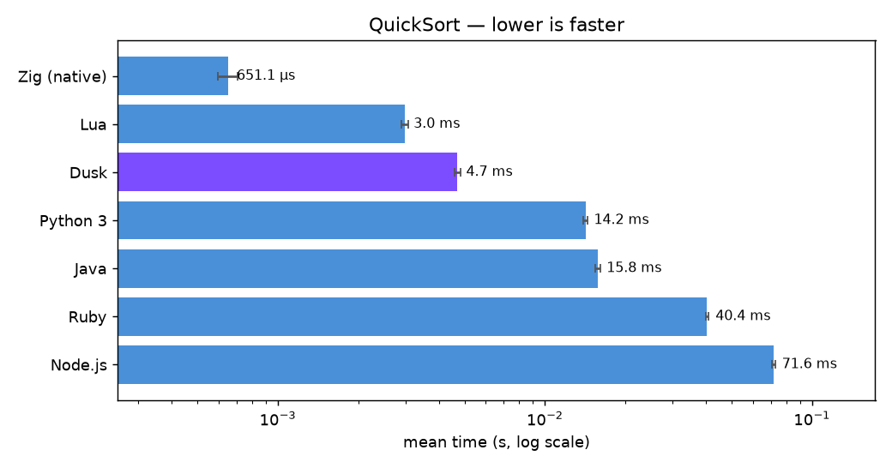

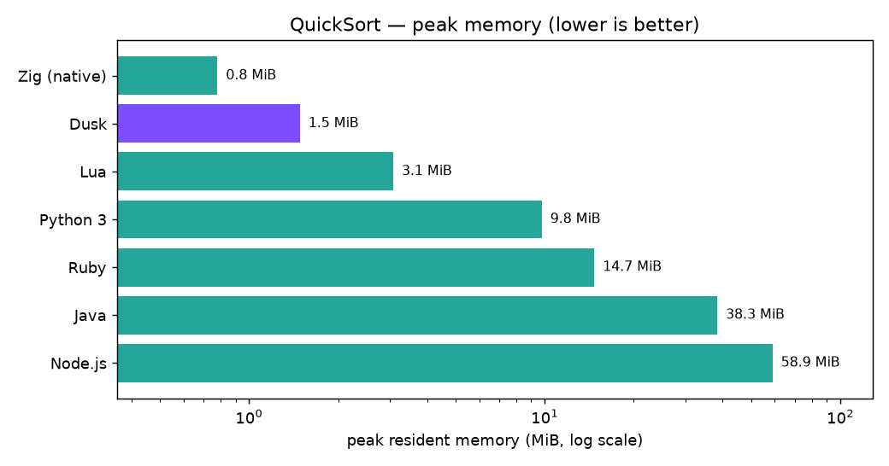

### Mandelbrot (`mandelbrot`)

800x800 grid, up to 1000 iterations per pixel (identical IEEE-754 double math everywhere); print the sum of all iteration counts as a checksum.

Expected output: `141554306`

| Language | Mean | Std dev | Min | Max | Relative | Peak mem |
| --- | --- | --- | --- | --- | --- | --- |
| Zig (native) | 306.0 ms | 42.3 µs | 306.0 ms | 306.1 ms | 1.00× | 0.7 MiB |
| Java | 329.0 ms | 417.9 µs | 328.1 ms | 329.5 ms | 1.07× | 38.9 MiB |
| Node.js | 379.8 ms | 530.0 µs | 379.1 ms | 380.6 ms | 1.24× | 60.8 MiB |
| Lua | 4.387 s | 108.8 ms | 4.250 s | 4.525 s | 14.33× | 3.0 MiB |
| **Dusk** | **7.713 s** | **54.2 ms** | **7.640 s** | **7.772 s** | **25.20×** | **1.2 MiB** |
| Ruby | 9.987 s | 330.3 ms | 9.691 s | 10.509 s | 32.63× | 14.6 MiB |
| Python 3 | 38.806 s | 806.4 ms | 38.205 s | 40.206 s | 126.80× | 9.5 MiB |

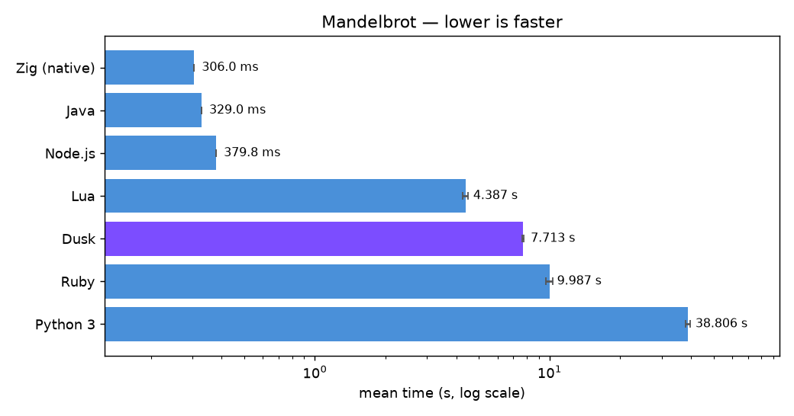

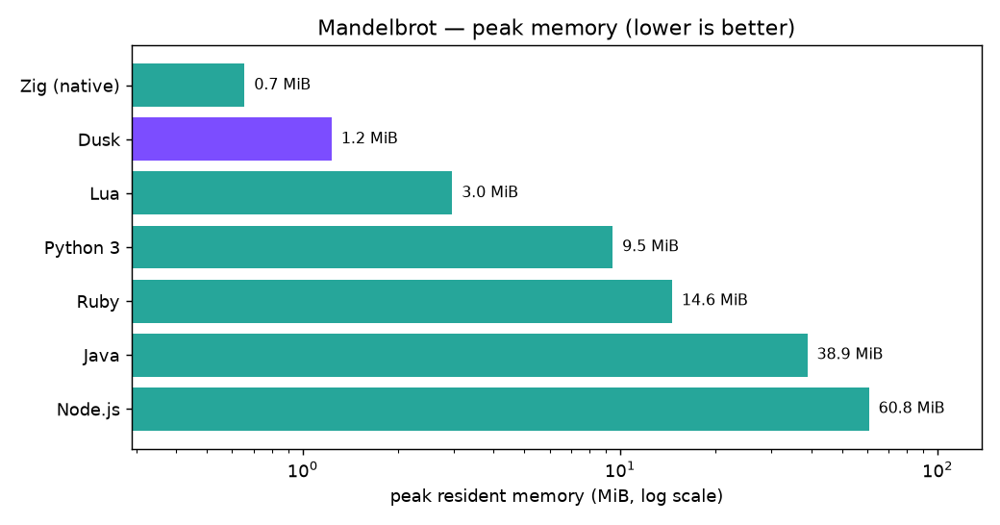

## Time summary

Slowdown of each language relative to the **Zig (native)** baseline in each benchmark (log scale).

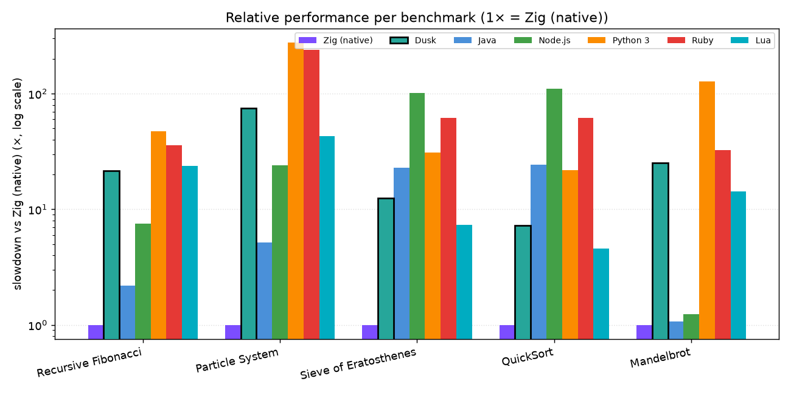

## Memory summary

Peak resident memory per benchmark (log scale).

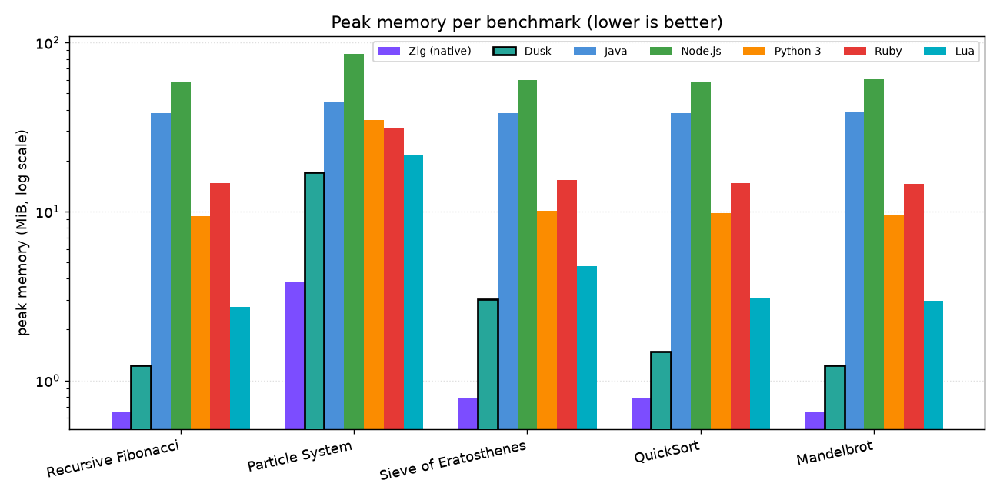
